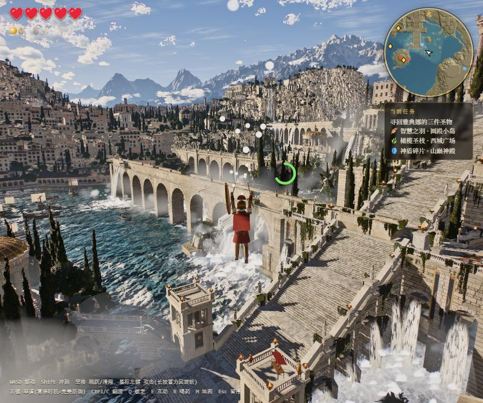
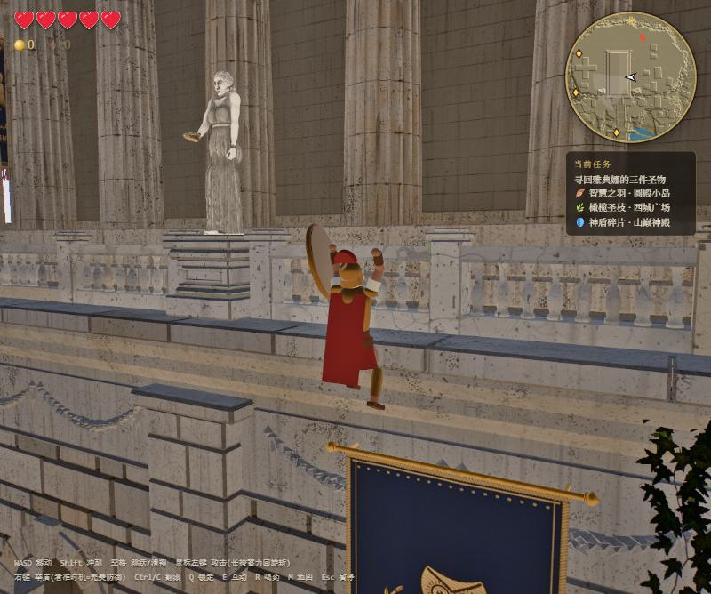
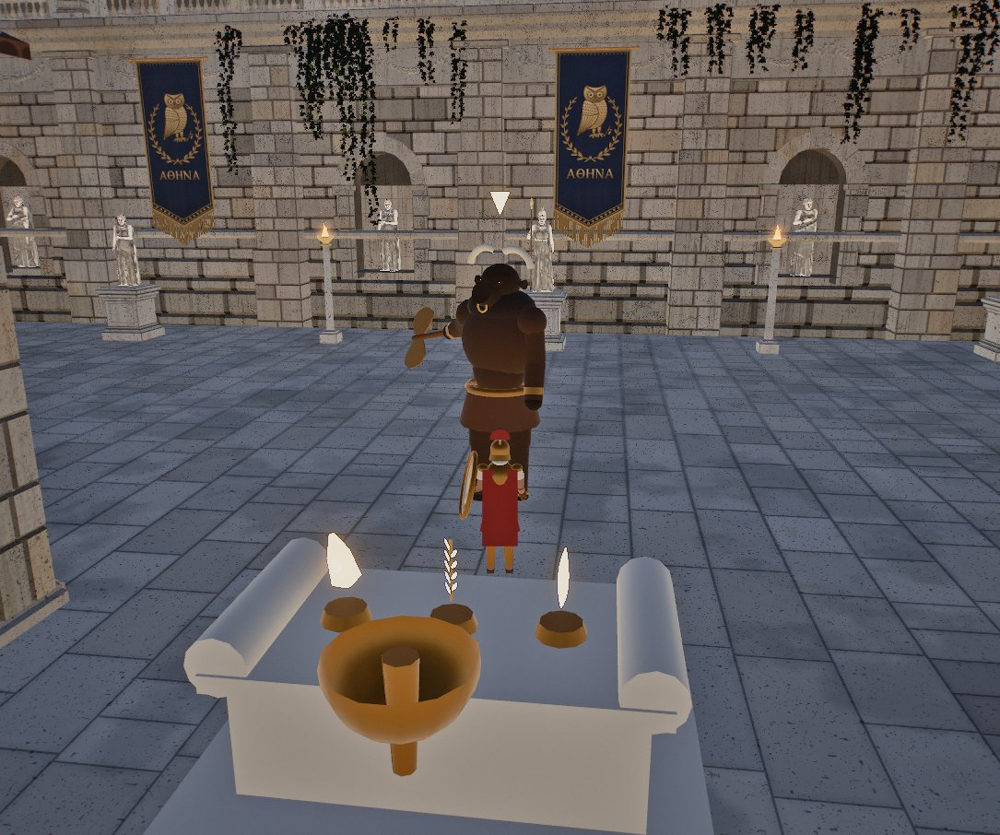
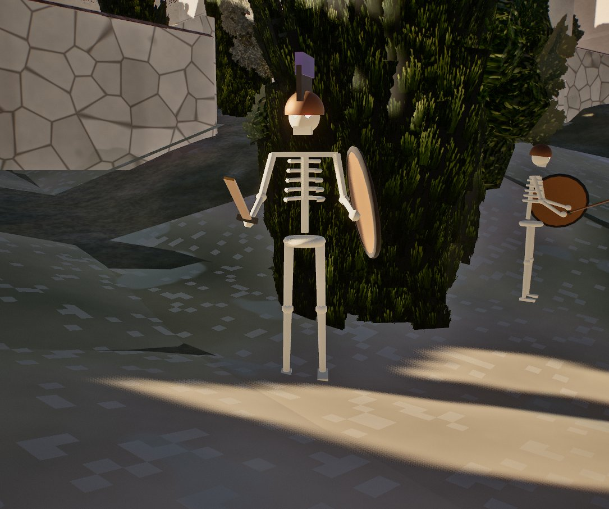

# 雅典娜之试炼 · Trials of Athena

一款运行在浏览器里的古希腊动作冒险游戏，玩法类似《塞尔达传说：旷野之息》：攀爬一切、乘风滑翔、剑盾战斗、寻回圣物、挑战米诺陶洛斯。

游戏建立在 [Athenaion](https://github.com/Leonxlnx/athenaion)（Leonxlnx 用 three.js 完全程序化生成的古希腊世界，MIT 协议）之上。
世界、角色、怪物、道具、音效和音乐**全部由代码生成，没有任何外部素材**。

*A Zelda-like action adventure built on top of the procedural ancient Greek world [Athenaion](https://github.com/Leonxlnx/athenaion). Climb anything, glide, fight with sword and shield, recover three relics and face the Minotaur — everything is generated in code.*

| | |
|---|---|
|  |  |
|  |  |

## 快速开始

需要 Node.js 18+ 和 Chrome / Edge（推荐独立显卡）。

```bash
git clone https://github.com/Liyucheng1997/trials-of-athena.git
cd trials-of-athena
npm install
node tools/bake.mjs terrain     # 烘焙地形网格，只需一次（约 10 秒）
node tools/bake.mjs statues     # 可选：烘焙雕像，加快加载
node tools/bake.mjs head        # 可选：烘焙巨石头像
npm run game
```

打开 http://localhost:8080/ ，等进度条走完（首次 15–60 秒），点「开始冒险」。

## 玩法

- **自由探索**：走向任何墙壁、悬崖、神殿即可攀爬；从高处跃下、空中再按空格展开滑翔翼；可以游泳。攀爬、滑翔、冲刺、游泳都消耗体力。
- **战斗**：三段剑击连招、长按蓄力回旋斩、举盾防御（受击瞬间举盾 = 完美防御）、翻滚闪避、锁定目标。
- **敌人**：龙牙骷髅兵与骷髅队长、卡吕冬野猪、鹰身女妖，以及最终 Boss 米诺陶洛斯。
- **剧情**：神谕女祭司皮提亚请你寻回雅典娜的三件圣物：智慧之羽、橄榄圣枝、神盾碎片，供奉在卫城祭坛上重燃圣火。
- **收集**：打碎陶罐、击败怪物获得德拉克马，在码头商人处购买药水、心之容器、体力之瓶；野外藏有宝箱。

| 按键 | 作用 |
|---|---|
| WASD / Shift | 移动 / 冲刺 |
| 鼠标 / 滚轮 | 视角 / 缩放 |
| 空格 | 跳跃；空中 = 滑翔 |
| 左键 | 攻击（长按 = 回旋斩） |
| 右键 | 举盾 |
| Ctrl / C | 翻滚；攀爬时松手 |
| Q | 锁定 |
| E | 互动 |
| R | 喝药 |
| M / Esc | 地图 / 暂停 |

完整说明、代码结构与实时渲染优化见 [GAME.md](GAME.md)。

## 原版场景

原 Athenaion 的离线渲染与场景查看器仍然完整保留：http://localhost:8080/index.html?shot=1 ，说明见 [ATHENAION.md](ATHENAION.md)。

## 致谢与协议

- 世界与渲染引擎：[Athenaion](https://github.com/Leonxlnx/athenaion) by Leonxlnx，由 Claude Code 构建，MIT 协议。
- 游戏层（`src/game/`、`game.html`）及为实时运行所做的引擎改动：Yucheng Li，由 Claude Code 协助开发。
- 基于 [three.js](https://threejs.org)。

MIT License，见 [LICENSE](LICENSE)。
